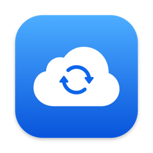
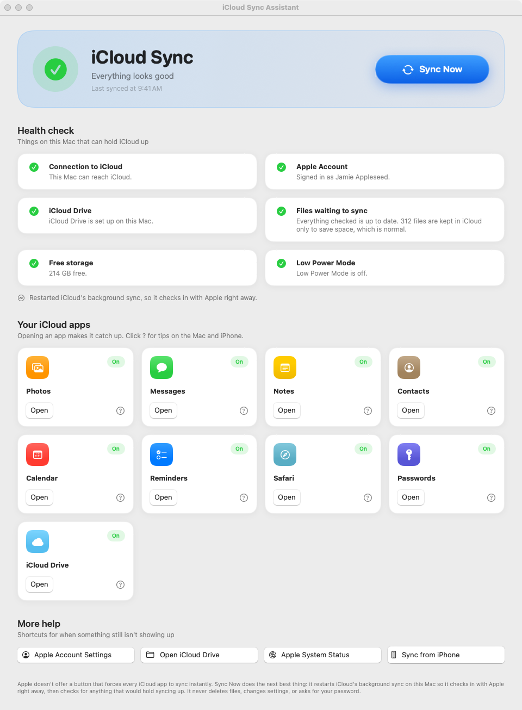
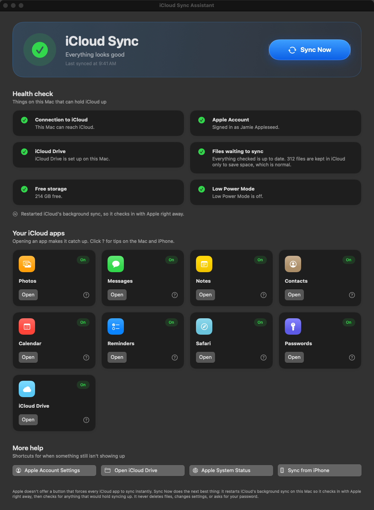
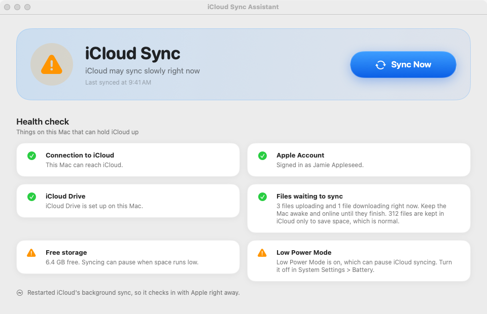

<p align="center">
  
</p>

<h1 align="center">iCloud Sync Assistant</h1>

<p align="center">
  A small Mac app with one big <b>Sync Now</b> button. It wakes up iCloud and shows in plain English whether anything is stopping your Mac and iPhone from staying in sync.
</p>

<p align="center">
  <a href="https://github.com/kbaker827/icloud-sync-assistant/releases/latest"><b>Download for Mac</b></a> ·
  <a href="https://github.com/kbaker827/icloud-sync-assistant/actions/workflows/ci.yml"></a>
</p>

<p align="center">
  
</p>

## Screenshots

| Dark mode | When something needs attention |
| --- | --- |
|  |  |

<sub>Screenshots use built-in demo data, not a real account.</sub>

## Download and install

1. Go to the [latest release](https://github.com/kbaker827/icloud-sync-assistant/releases/latest) and download **iCloud-Sync-Assistant-….zip**.
2. Double-click the zip, then drag **iCloud Sync Assistant** into **Applications**.
3. Open it. The app isn't from the App Store, so the first time macOS blocks it:
   - Open **System Settings > Privacy & Security**, scroll down, click **Open Anyway**, then confirm.
   - On macOS 14 or earlier you can instead right-click the app, choose **Open**, then click **Open**.
4. Click **Sync Now**. If macOS asks to let the app see iCloud Drive, click **Allow**.

It needs macOS 13 Ventura or newer and runs on both Apple silicon and Intel Macs.

## What Sync Now does

Apple doesn't offer a button or command that forces every iCloud app to sync instantly. Sync Now does the closest thing macOS allows:

1. **Restarts iCloud's background sync on this Mac.** It quits the `bird` (iCloud Drive) and `cloudd` (CloudKit: Notes, Photos, Reminders and more) processes for your user account. macOS starts them again within seconds, and on start-up they check in with Apple's servers. This is the same trick Apple Support often suggests, and it doesn't need an admin password.
2. **Runs a health check**, with a plain-language result for each item:

| Check | What it looks at |
| --- | --- |
| Connection to iCloud | Whether this Mac can reach `icloud.com` |
| Apple Account | Whether the Mac is signed in to iCloud, and which account |
| iCloud Drive | Whether iCloud Drive is set up on this Mac |
| Files waiting to sync | Files uploading, downloading, kept in iCloud only, or stuck with errors (checks up to 5,000 files) |
| Free storage | Whether low disk space could pause downloads |
| Low Power Mode | Whether Low Power Mode is pausing background syncing |

The dashboard also has cards for **Photos, Messages, Notes, Contacts, Calendar, Reminders, Safari, Passwords and iCloud Drive**. Each card shows whether that feature is on for this Mac, opens the app (which makes it catch up), and has a **?** button with step-by-step tips for both the Mac and the iPhone. There's also a **Sync from iPhone** guide, plus shortcuts to Apple Account settings and Apple's System Status page.

### What it never does

- It never asks for your Apple Account password.
- It never deletes, moves or changes files.
- It never changes iCloud or system settings.
- It never sends anything anywhere. The only network request is a check that `icloud.com` is reachable.

## Build it yourself

You need a Mac with Xcode 15 or newer (or the Swift 5.9+ command-line tools).

```bash
swift test                     # run the unit tests
swift run iCloudSyncAssistant  # run the app straight from source
scripts/package-app.sh         # build dist/iCloud Sync Assistant.app and a zip
```

### Project layout

```
Sources/SyncCore/            Logic: checks, account and iCloud Drive readers, service restart, view model
Sources/iCloudSyncAssistant/ SwiftUI app: dashboard, cards, help sheet
Tests/SyncCoreTests/         Unit tests (CI requires 80%+ line coverage of SyncCore)
scripts/                     Packaging, icon generation, coverage gate
```

### Releasing

Bump `VERSION`, then push a tag:

```bash
git tag v2.0.1 && git push origin v2.0.1
```

The Release workflow tests the code, builds a universal, ad-hoc-signed app and attaches the zip to a GitHub release.

> The app is ad-hoc signed, not notarized, which is why macOS asks for **Open Anyway** the first time. To skip that prompt you'd need to sign it with a paid Apple Developer ID and notarize it.

## License

MIT
